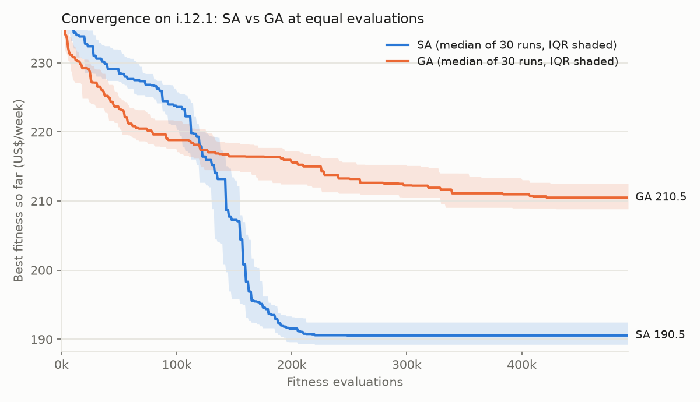
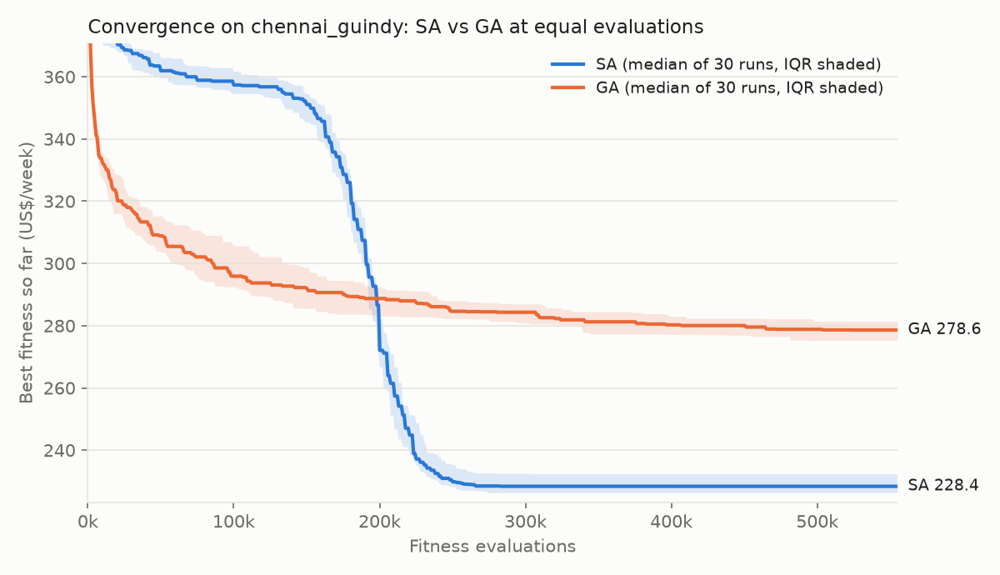
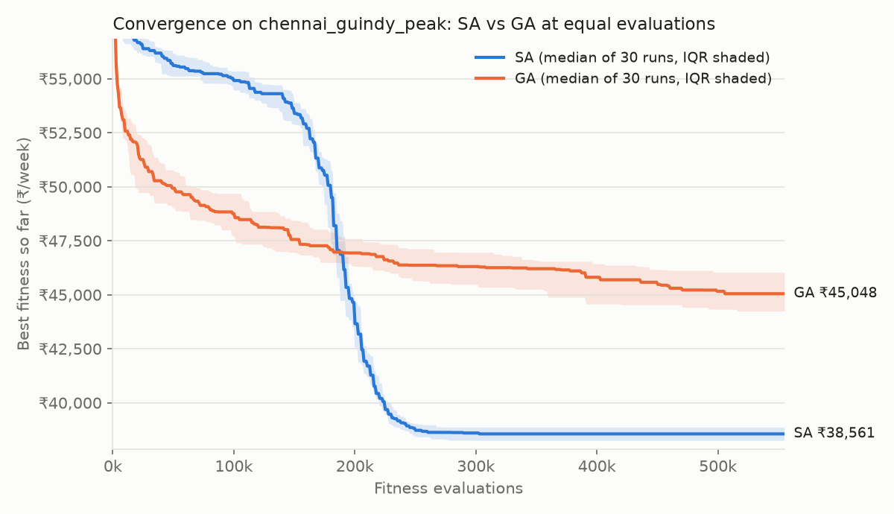
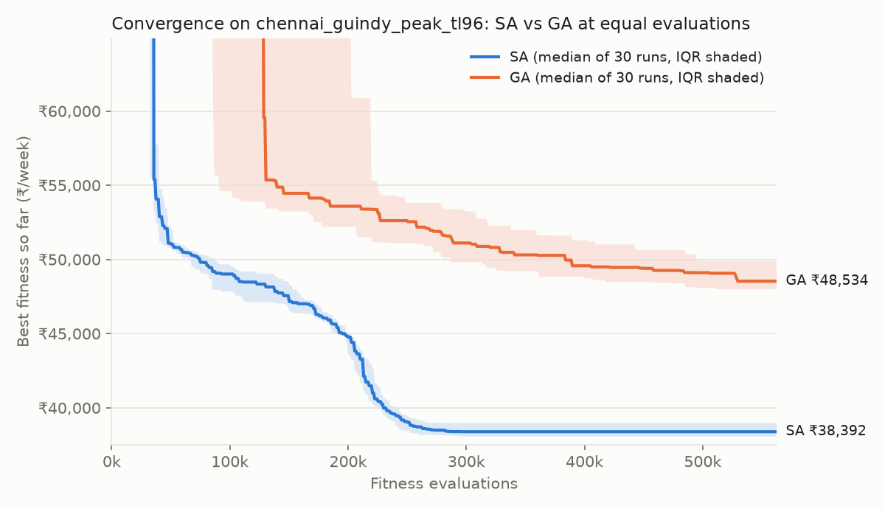

# Experiment summary

Each run is one seed; SA and GA are matched on fitness-function evaluations (see `results/calibration_*.txt`). All costs are per week, in each instance's own currency:

- **i.12.1**: US dollars (US$), the paper's own cost parameters.
- **chennai_guindy**: Indian rupees (₹). These figures are an FX conversion of the paper's US$ cost parameters at 96.3789 ₹/US$, **not** independently sourced Indian rates.
- **chennai_guindy_peak**: Indian rupees (₹). These figures are an FX conversion of the paper's US$ cost parameters at 96.3789 ₹/US$, **not** independently sourced Indian rates.
- **chennai_guindy_peak_tl96**: Indian rupees (₹). These figures are an FX conversion of the paper's US$ cost parameters at 96.3789 ₹/US$, **not** independently sourced Indian rates.

## Results by instance and algorithm

| Instance | Algo | n | Min | Median | Mean | 95% CI | Mean evals | Mean runtime (s) | All feasible |
|---|---|---|---|---|---|---|---|---|---|
| i.12.1 | SA | 30 | 186.47 US$ | 190.54 US$ | 190.77 US$ | [189.94 US$, 191.60 US$] | 445,583 | 41.6 | yes |
| i.12.1 | GA | 30 | 205.47 US$ | 210.48 US$ | 210.68 US$ | [209.52 US$, 211.84 US$] | 445,600 | 201.5 | yes |
| chennai_guindy | SA | 30 | ₹29,250.84 | ₹30,014.38 | ₹30,079.05 | [₹29,941.63, ₹30,216.48] | 522,000 | 230.3 | yes |
| chennai_guindy | GA | 30 | ₹33,597.28 | ₹34,910.32 | ₹34,954.69 | [₹34,679.51, ₹35,229.86] | 522,000 | 595.4 | yes |
| chennai_guindy_peak | SA | 30 | ₹37,378.69 | ₹38,560.64 | ₹38,546.95 | [₹38,368.87, ₹38,725.03] | 517,333 | 101.1 | yes |
| chennai_guindy_peak | GA | 30 | ₹43,256.16 | ₹45,048.30 | ₹45,198.75 | [₹44,806.82, ₹45,590.67] | 517,300 | 518.6 | yes |
| chennai_guindy_peak_tl96 | SA | 30 | ₹37,552.96 | ₹38,391.96 | ₹38,608.36 | [₹38,326.80, ₹38,889.92] | 531,917 | 183.7 | yes |
| chennai_guindy_peak_tl96 | GA | 30 | ₹44,295.91 | ₹48,533.59 | ₹48,920.28 | [₹48,167.54, ₹49,673.02] | 531,900 | 1311.4 | NO |

Evaluation matching (GA vs mean SA evaluations):

- i.12.1: SA 445,583 (range 340,000–492,500), GA 445,600 → +0.00%
- chennai_guindy: SA 522,000 (range 490,000–550,000), GA 522,000 → +0.00%
- chennai_guindy_peak: SA 517,333 (range 467,500–555,000), GA 517,300 → -0.01%
- chennai_guindy_peak_tl96: SA 531,917 (range 492,500–562,500), GA 531,900 → -0.00%

## i.12.1 against the paper

Paper: Table 9 (SA, min 188.0 / mean 193.7) and Table 10 (MILP optimum, overall 178.42). Both sides in US$.

| Metric | Ours | Paper | Difference |
|---|---|---|---|
| SA min | 186.47 | SA min 188.0 | -0.81% |
| SA mean | 190.77 | SA mean 193.7 | -1.51% |
| SA min | 186.47 | MILP 178.42 | +4.51% |
| SA mean | 190.77 | MILP 178.42 | +6.92% |
| GA min | 205.47 | SA min 188.0 | +9.29% |
| GA mean | 210.68 | SA mean 193.7 | +8.76% |
| GA min | 205.47 | MILP 178.42 | +15.16% |
| GA mean | 210.68 | MILP 178.42 | +18.08% |

## SA vs GA: Mann-Whitney U test (overall cost, two-sided)

| Instance | n (SA, GA) | U | p-value | Median SA | Median GA | Verdict (α = 0.05) |
|---|---|---|---|---|---|---|
| i.12.1 | 30, 30 | 0.0 | 3.02e-11 | 190.54 US$ | 210.48 US$ | significant — SA lower |
| chennai_guindy | 30, 30 | 0.0 | 3.02e-11 | ₹30,014.38 | ₹34,910.32 | significant — SA lower |
| chennai_guindy_peak | 30, 30 | 0.0 | 3.02e-11 | ₹38,560.64 | ₹45,048.30 | significant — SA lower |
| chennai_guindy_peak_tl96 | 30, 30 | 0.0 | 3.02e-11 | ₹38,391.96 | ₹48,533.59 | significant — SA lower |

## chennai_guindy: cost breakdown (INR)

| Algo | | Bin cost | Routing cost | Overall |
|---|---|---|---|---|
| SA | mean | ₹7,526.58 | ₹22,552.47 | ₹30,079.05 |
| SA | median | ₹7,485.75 | ₹22,607.77 | ₹30,014.38 |
| SA | best (seed 16) | ₹6,696.41 | ₹22,554.44 | ₹29,250.84 |
| GA | mean | ₹8,020.17 | ₹26,934.51 | ₹34,954.69 |
| GA | median | ₹8,019.21 | ₹27,027.55 | ₹34,910.32 |
| GA | best (seed 15) | ₹8,277.98 | ₹25,319.30 | ₹33,597.28 |

## chennai_guindy_peak: cost breakdown (INR)

| Algo | | Bin cost | Routing cost | Overall |
|---|---|---|---|---|
| SA | mean | ₹7,994.12 | ₹30,552.84 | ₹38,546.95 |
| SA | median | ₹8,034.15 | ₹30,556.54 | ₹38,560.64 |
| SA | best (seed 20) | ₹7,998.48 | ₹29,380.21 | ₹37,378.69 |
| GA | mean | ₹7,965.91 | ₹37,232.84 | ₹45,198.75 |
| GA | median | ₹8,031.25 | ₹37,186.21 | ₹45,048.30 |
| GA | best (seed 18) | ₹8,064.02 | ₹35,192.14 | ₹43,256.16 |

## chennai_guindy_peak_tl96: cost breakdown (INR)

| Algo | | Bin cost | Routing cost | Overall |
|---|---|---|---|---|
| SA | mean | ₹7,842.00 | ₹30,766.36 | ₹38,608.36 |
| SA | median | ₹7,878.01 | ₹30,644.87 | ₹38,391.96 |
| SA | best (seed 13) | ₹7,650.56 | ₹29,902.40 | ₹37,552.96 |
| GA | mean | ₹8,214.50 | ₹40,705.78 | ₹48,920.28 |
| GA | median | ₹8,158.96 | ₹40,211.06 | ₹48,533.59 |
| GA | best (seed 25) | ₹8,039.93 | ₹36,255.98 | ₹44,295.91 |

## Chennai: free-flow vs peak-hour traffic

The peak scenarios multiply every OSRM travel time by 1.5. All use the same points, depot, bins and rupee cost parameters. Under Eq. (10) the shift limit TL is derived from the travel-time matrix, so in the plain peak scenario it grows with traffic (96 → 144 min). The third scenario holds TL at the free-flow 96 min (`load_instance(..., TL=96)`, `runner.py --tl 96`), so congestion has to be absorbed within the original shift.

Best solution per scenario (`chennai_guindy_sa_seed16`, `chennai_guindy_peak_sa_seed20`, `chennai_guindy_peak_tl96_sa_seed13`), the 30-run SA mean, and feasibility over all 60 runs (30 SA + 30 GA). Changes in brackets are relative to free-flow.

| | Free-flow | Peak (×1.5) | Peak, shift limit held at 96 min |
|---|---|---|---|
| Shift limit TL (min) | 96 | 144 (+50.00%) | 96 (+0.00%) |
| Overall cost (best) | ₹29,250.84 | ₹37,378.69 (+27.79%) | ₹37,552.96 (+28.38%) |
| Bin cost (best) | ₹6,696.41 | ₹7,998.48 (+19.44%) | ₹7,650.56 (+14.25%) |
| Routing cost (best) | ₹22,554.44 | ₹29,380.21 (+30.26%) | ₹29,902.40 (+32.58%) |
| Overall cost (SA mean of 30) | ₹30,079.05 | ₹38,546.95 (+28.15%) | ₹38,608.36 (+28.36%) |
| Routes per week (best) | 7 | 7 (+0.00%) | 7 (+0.00%) |
| Total route time (min, best) | 406.0 | 528.9 (+30.26%) | 538.3 (+32.58%) |
| Longest route (min, best) | 68.7 | 84.5 (+22.90%) | 84.8 (+23.37%) |
| Longest route / TL (best) | 72% | 59% | 88% |
| Routes over TL (best) | 0 | 0 | 0 |
| Penalty (best) | ₹0.00 | ₹0.00 | ₹0.00 |
| Feasible (best) | yes | yes | yes |
| Feasible runs (SA + GA) | 60 / 60 | 60 / 60 | 59 / 60 |
| Runs with a route over TL | 0 / 60 | 0 / 60 | 1 / 60 |
| Routes over TL, all runs | 0 of 430 | 0 of 423 | 1 of 482 |

- Peak (×1.5): bin combinations differ from free-flow at 9 of 21 points.
- Peak, shift limit held at 96 min: bin combinations differ from free-flow at 7 of 21 points.
- The shift-length penalty (Eq. 7) is γ × minutes over the limit, here ₹96,379 per minute (γ = 1000 US$, converted), about 1,735× the cost of a minute of route time. Any route over TL therefore dominates the fitness, and the optimisers treat TL as a hard constraint.
- Infeasible run: GA seed 9 ended with 1 route(s) over 96 min (longest 96.37 min). Its penalty is ₹35,660.19, on top of a ₹54,421.22 plan, a fitness of ₹90,081.41: that run never found a feasible plan cheaper than this penalised one.

**Does holding the shift at 96 min bind?** The plain-peak runs, re-checked against the pinned limit, and plain vs pinned overall cost (two-sided Mann-Whitney U):

| Algo | Plain-peak runs that would break 96 min | Longest plain-peak route (min) | Median cost plain → pinned | p-value |
|---|---|---|---|---|
| SA | 2 / 30 | 98.9 | ₹38,560.64 → ₹38,391.96 (-0.44%) | 0.695 |
| GA | 30 / 30 | 126.1 | ₹45,048.30 → ₹48,533.59 (+7.74%) | 1.69e-09 |

## Dynamic-programming route polish

`src/dp_router.py` is an opt-in layer (`runner.py --polish`, `exporter.py --polish`, `src/polish_experiment.py`). For a solution found by SA or GA it keeps the schedule, bins and waste fixed and replaces each day's greedy route split with the exact optimum: Held–Karp gives the best closed tour for every subset of the day's points, and a partition DP picks the cheapest set of at most nV routes within Q and TL. A day is replaced only if that is strictly shorter, so bin cost is unchanged and routing cost cannot rise. SA and GA themselves are unchanged, and the Appendix A validation never touches this code. A worked example by hand is in `docs/dp_dry_run.md`.

### Complexity against day size

For n points in a day and a fleet of K = 3: Held–Karp does n²·2ⁿ steps and keeps an n·2ⁿ table; the partition DP looks at every (set, subset containing its first point) pair, (3ⁿ − 1)/2 of them, each for K route counts. Measured times are `dp_day_routes` on the Chennai matrix with 1 m³ per point (`polish_experiment.py --benchmark`, median of 5).

| Points in the day | Held–Karp steps n²·2ⁿ | Partition steps K·(3ⁿ−1)/2 | DP tables (MB) | Measured time |
|---|---|---|---|---|
| 4 | 256 | 120 | 0.0 | 0.014 ms |
| 6 | 2,304 | 1,092 | 0.0 | 0.049 ms |
| 8 | 16,384 | 9,840 | 0.0 | 0.239 ms |
| 10 | 102,400 | 88,572 | 0.2 | 1.733 ms |
| 12 | 589,824 | 797,160 | 0.7 | 11.274 ms |
| 13 | 1,384,448 | 2,391,483 | 1.5 | 30.937 ms |
| 14 ← MAX_DP_POINTS | 3,211,264 | 7,174,452 | 3.1 | 82.935 ms |
| 15 | 7,372,800 | 21,523,359 | 6.5 | 187.745 ms |
| 16 | 16,777,216 | 64,570,080 | 13.6 | 535.759 ms |
| 18 | 84,934,656 | 581,130,732 | 59.2 | ≈ 5 s (extrapolated ×3 per point) |
| 21 | 924,844,032 | 15,690,529,803 | 530.6 | ≈ 130 s (extrapolated ×3 per point) |

**Why the threshold is 14:** each extra point multiplies the work by about 3. At 14 points a day takes under 0.1 s, so polishing a whole week stays interactive; at 16 it is already about half a second per day.

**Why not DP for the whole problem at 21 points:** routing alone for one 21-point day would need about 2·10¹⁰ partition steps (minutes per day) and over 0.5 GB of tables. That is too slow to sit inside SA or GA, which evaluate about 500,000 candidate schedules per run. Choosing the schedule as well is far beyond it: each of 21 points can be collected on any subset of 6 working days, 2¹²⁶ ≈ 10³⁸ schedules. Each schedule changes every day's loads through the waste accumulation (Eq. 2l) and every point's bin, so the problem does not split into independent days. DP is therefore used where it is exact and cheap: the routing of one day, once the metaheuristic has fixed the schedule.

### Polishing the saved best solutions

The best solution of each of the 30 SA and 30 GA seeds, as saved by the runs above, polished without re-running SA or GA (`python src/polish_experiment.py`; per-seed results in `results/polish_<instance>_<algo>.csv`).

| Instance | Algo | Mean routing gain | Best overall before → after | Seeds changed | Days improved | Mean DP time / day | Days skipped (> 14 points) |
|---|---|---|---|---|---|---|---|
| i.12.1 | SA | 0.06 US$ (0.04%) | 186.47 US$ → 186.32 US$ | 14 / 30 | 17 / 180 | 0.17 ms | 0 |
| i.12.1 | GA | 10.36 US$ (6.39%) | 205.47 US$ → 193.44 US$ | 30 / 30 | 163 / 180 | 0.26 ms | 0 |
| chennai_guindy | SA | ₹55.85 (0.24%) | ₹29,250.84 → ₹29,242.51 | 19 / 30 | 26 / 180 | 3.10 ms | 0 |
| chennai_guindy | GA | ₹2,421.64 (8.95%) | ₹33,597.28 → ₹31,272.39 | 30 / 30 | 165 / 179 | 4.05 ms | 0 |
| chennai_guindy_peak | SA | ₹28.00 (0.09%) | ₹37,378.69 → ₹37,378.69 | 18 / 30 | 23 / 180 | 2.08 ms | 0 |
| chennai_guindy_peak | GA | ₹4,017.52 (10.76%) | ₹43,256.16 → ₹39,715.24 | 30 / 30 | 178 / 180 | 3.50 ms | 0 |

On i.12.1 the best SA solution polishes to 186.32 US$: +4.43% relative to the MILP optimum of 178.42 (Table 10), and -0.89% relative to the paper's SA minimum of 188.0. Polishing the paper's own Appendix A solution changes none of its 6 days: its published routes are already optimal for its schedule.

### Does DP polish narrow the SA–GA gap?

Mean overall cost of the 30 seeds, before and after polish, and a two-sided Mann-Whitney U test of SA+DP against GA+DP:

| Instance | SA → SA+DP | GA → GA+DP | GA − SA gap before → after | Gap closed | U, p (SA+DP vs GA+DP) |
|---|---|---|---|---|---|
| i.12.1 | 190.77 US$ → 190.71 US$ | 210.68 US$ → 200.31 US$ | 19.91 US$ (10.4%) → 9.60 US$ (5.0%) | 52% | U = 8, p = 6.7e-11 |
| chennai_guindy | ₹30,079.05 → ₹30,023.21 | ₹34,954.69 → ₹32,533.05 | ₹4,875.63 (16.2%) → ₹2,509.84 (8.4%) | 49% | U = 0, p = 3.02e-11 |
| chennai_guindy_peak | ₹38,546.95 → ₹38,518.95 | ₹45,198.75 → ₹41,181.22 | ₹6,651.79 (17.3%) → ₹2,662.27 (6.9%) | 60% | U = 0, p = 3.02e-11 |

DP polish closes 49%–60% of the gap. GA gains far more from polish than SA (6–11% of routing cost against under 0.3%). A likely reading: SA's exchange moves keep refining the visiting orders of a schedule, while GA's crossover recombines orders and leaves poor ones; that part of GA's deficit is route construction, which DP removes. The rest is the schedule itself (which days each point is collected, hence the bins and loads), which DP holds fixed. Mean bin cost, SA vs GA: i.12.1 47.27 US$ vs 48.65 US$; chennai_guindy ₹7,526.58 vs ₹8,020.17; chennai_guindy_peak ₹7,994.12 vs ₹7,965.91. SA+DP still beats GA+DP on every instance, so the ranking stands, but the margin by which GA loses is roughly halved.

## Convergence

Median best fitness over all seeds against evaluations spent; the shaded band is the interquartile range. A run that stopped early holds its final value. The y-axis leaves out penalised infeasible solutions (it starts after the first 5% of the budget and is capped at 1.3× the final values); where a curve enters from above the frame, the median run was still infeasible.

## Notes for reading these results

- The MILP value (Table 10) is the proven optimum for i.12.1, so the "vs MILP" rows are optimality gaps. Only SA and MILP figures from the paper are compared here.
- A Mann-Whitney U of 0 means complete separation: every SA run beat every GA run. With 30 runs each, every instance with complete separation gets the same p-value (normal approximation).
- Evaluations are matched, wall time is not. GA's crossover, mutation and repair are pure Python, while the decoder is compiled, so GA takes ~5× longer for the same number of evaluations. Runtimes were measured with 11 runs in parallel, which is about 4× slower per run than running alone.
- SA's evaluation count varies by seed because it stops after 100 non-improving temperature steps. GA's generations were set from the 30-run SA mean (see `overnight_log.md`).
- The Chennai runs (2026-10-02) ran on battery power, so the CPU was throttled by varying amounts. Their runtimes are not comparable with i.12.1's or with each other; evaluation counts are the fair measure of effort.
- Rupee figures are the paper's US$ cost parameters converted at 96.3789 ₹/US$ (mid-market, 2026-10-02, https://open.er-api.com/v6/latest/USD). The penalty weights and SA's final temperature are converted too, so the optimisation problem is the same as in US$. Locally sourced Greater Chennai Corporation rates would change the bin-vs-routing tradeoff, not just the totals.

